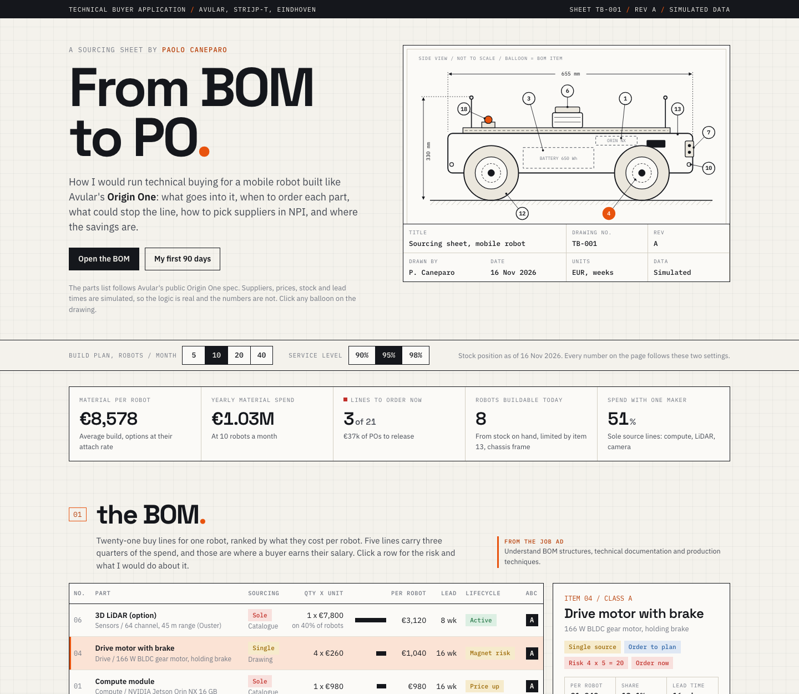

# From BOM to PO.

A one-page sourcing sheet for a mobile robot built like **Avular's Origin One**, made for my application to the Technical Buyer role at Avular.

**Live page:** https://leonida300-gg.github.io/avular-technical-buying/

## What it shows

| Section | Job responsibility | What you can do |
|---|---|---|
| **the BOM.** | BOM structures, technical documentation | 21 buy lines ranked by cost per robot, with sourcing, lead time, lifecycle and ABC class. Click a line, or a balloon on the drawing, for the risk and the mitigation. |
| **the re-order rules.** | Re-order rules from production planning and consumption | One rule per part type (order to plan, reorder point, two bins), with safety stock, reorder point, cover vs lead time, status and the suggested PO. |
| **the risk radar.** | Lifecycles, market developments, supply risks, alternatives | Likelihood x impact for every line, plus four real 2025 and 2026 signals: the memory squeeze on Jetson modules, rare earth licensing for motor magnets, RealSense leaving Intel, and EU Batteries Regulation dates. |
| **the NPI call.** | Supplier selection, production techniques, DFM | Break-even of CNC, sheet metal and die-cast for the chassis frame at the planned volume, and a weighted EMS scorecard with four weighting presets. |
| **the deal.** | Negotiation, budgets, savings | A yearly savings plan against a 4% target, and a negotiation prep card for the battery pack. |
| **the first 90 days.** | Process ownership, ERP | What I would do in months one, two and three, what I bring, and what I am still learning. |

Two controls at the top (build plan in robots per month, and service level) recalculate every number on the page.

## The method

* **Need per week** = build plan x qty per robot x attach rate x (1 + spares) / 4.33
* **Safety stock** = z x 0.35 x need per week x √lead time (z = 1.28 / 1.65 / 2.05 for 90 / 95 / 98% service)
* **Reorder point** = need per week x lead time + safety stock
* **Suggested PO** = need over (lead time + review period) + safety stock, minus stock and open POs, rounded up to the MOQ
* **Cost per robot** for a production technique = unit cost + tooling / (3 x yearly volume)

## Data

The part list follows Avular's public [Origin One documentation](https://avular-robotics.github.io/origin_one/1.0-1/platform_specs/) (Jetson Orin NX, 650 Wh pack, four 166 W motors with holding brakes, RealSense D435f, optional Ouster LiDAR and RTK GNSS). Every supplier, price, stock level and lead time is simulated. Market signals are linked to their sources on the page. This project is not affiliated with or endorsed by Avular.

## Run it

One self-contained `index.html` with no build step and no dependencies apart from Google Fonts. Open it in any browser, or serve the folder with GitHub Pages.

Built by Paolo Caneparo, November 2026.
